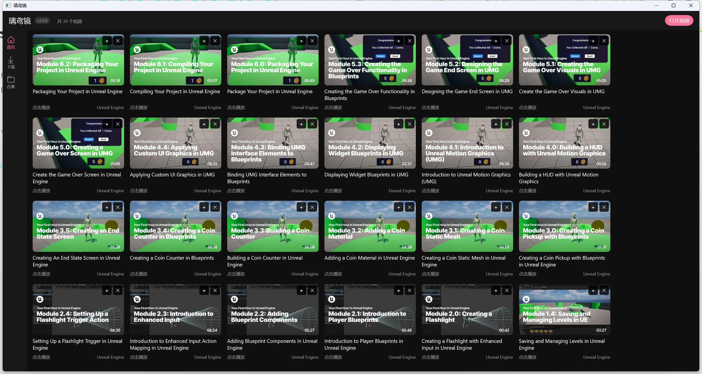

# 璃鸢镜（Lyra Viewer）v1.0.0

> 一个面向 Windows 的本地媒体播放器：自研 Vulkan / D3D11 视频渲染引擎 + WinUI 3 界面 + Python 后端。
> 支持 B 站 / YouTube 下载、弹幕、评论、字幕、AI 字幕（Whisper）、RTX VSR 超分、HDR、音频增强等。



## 功能

- **本地播放**：Vulkan 视频渲染（D3D11 回退）、HDR / HDR→SDR 色调映射、去隔行、FSRCNNX 超分、ICC 校色、字幕（SRT/VTT/ASS）
- **在线视频**：B 站 / YouTube 解析与下载；B 站弹幕、评论；视频库、合集、播放列表
- **字幕**：B 站 CC 字幕下载、YouTube 字幕抓取；**AI 字幕**（本地 Whisper，可选 tiny/base/small/medium/large-v3；每模型单独一版；繁→简统一；GPU/CPU 自动选择）
- **画质增强**：RTX VSR（NVIDIA RTX Video SDK）、Real-ESRGAN、RIFE 补帧、DeepFilterNet 降噪、LavaSR 音频超分
- **音频**：WASAPI 独占共享模式、Hi-Res 输出、ASIO 支持

## 目录结构

```
app/
  WinUIGui/         WinUI 3 前端（C#）
  dsh_engine/       自研 C++ 视频/音频引擎（Vulkan / D3D11 / WASAPI）
  backend/          Python 后端（标准库 HTTP 服务，B站/YouTube/字幕/AI）
  CHANGELOG.md      开发记录
  docs/             说明文档
packaging/
  setup.iss          Inno Setup 安装包脚本
third_party/
  rtx_vsr_bridge/    NVIDIA RTX VSR 的 C++ 桥接源码（需自行安装 RTX Video SDK，SDK 本体不入库）
```

## 构建 / 运行

### 1. 后端

```bat
py -3.10 -m venv app\backend\.venv
app\backend\.venv\Scripts\pip install -r app\backend\requirements.txt
app\backend\.venv\Scripts\python app\backend\run_backend.py --port 8765
```

需要 `yt-dlp`、`ffmpeg`（可放在 `app\backend\third_party\ffmpeg` 或 PATH）。AI 字幕/增强依赖不随仓库提供，在播放器设置里点「下载 AI 依赖 / 下载语音识别依赖」按需安装。

### 2. 前端

需要 Windows 10/11、.NET 10 SDK、Windows App SDK：

```bat
dotnet build app\WinUIGui\WinUIGui.csproj -c Release
```

### 3. 引擎

需要 Visual Studio（C++ 工具链）、Vulkan SDK、FFmpeg 开发库和 MinGW（工程当前使用 MinGW g++ 构建 `dsh_engine.dll`）。构建脚本见 `refs/rtx_vsr_bridge/build_engine.bat`（本地开发用路径，按自己的依赖位置修改）。

### 4. 安装包

先构建/部署到 `packaging/_pkg_t34/final`，再执行：

```bat
"D:\tools\Inno Setup 7\ISCC.exe" packaging\setup.iss
```

## 说明 / 许可

- 本仓库只包含项目源码与自有资源；**不包含**第三方 SDK 二进制、FFmpeg / Qt / Vulkan 运行库、Whisper 模型、下载的视频等大文件。
- **NVIDIA RTX Video SDK** 为 NVIDIA 专有许可，SDK 头文件/库/运行 DLL 不入库；使用 RTX VSR 功能需自行取得 SDK 并遵守其许可。
- 第三方组件遵循各自许可（FFmpeg LGPL/GPL、Qt LGPL/GPL、whisper MIT 等）。
- 本仓库根目录的 `LICENSE` 为 GNU GPL v3。

版本：**1.0.0**
